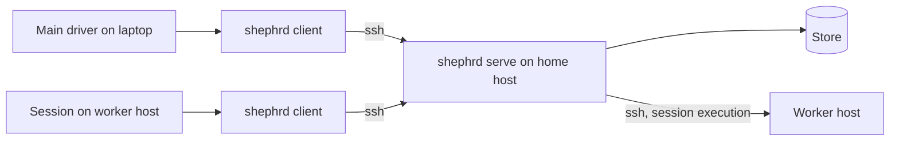

# Command surface and SSH parity

**Status:** approved. Implements the [system design](../design.md).

## Purpose

This spec defines how every caller invokes Shephrd, locally or from another host over SSH, and the conventions every command follows. Each system's spec defines the meaning of its own commands.

Parity holds by construction: there is one binary and one command tree, and a forwarded request runs the same command code on the home host as a local one. There is no second command list for remote callers to drift from. Surface callers are intentionally restricted to the ingress commands below.

## Topology

- **Home host:** holds the store and runs `shephrd daemon`. It may also run sessions. Its configuration has no `home`. Exactly one per installation.
- **Client host:** configuration sets `home` to an SSH target. Every public command run there is forwarded to the home host, except `init` and `version`, which describe the local machine.
- **Worker host:** a client host where sessions run. Session execution reaches it over SSH to create workspaces and start runs.

Put the home host where sessions run most and keep it always on. Sessions report constantly and the daemon wakes sub-drivers constantly, so that traffic stays local. If the home host sleeps, delegation pauses with it.



On a single machine, that machine is the home host and nothing is forwarded. This is the default.

### Example: three machines

| Machine | Role | Runs |
|---|---|---|
| `workhorse` | Home host | Store, daemon, registered repositories, sub-drivers and workers |
| `hermes` | Client host | The main driver, whose commands are forwarded to `workhorse` |
| `laptop` | Worker host, or its own installation | Extra sub-drivers and workers for `workhorse`, or a separate Shephrd with its own home |

In manual mode, the main driver on `hermes` is just a caller. It connects outbound over SSH as `driver:main`, including for `inbox wait`; there is no driver registry, main-driver run or home-to-client injection. The surface mailbox does not start a coordinator or change this mode. If `hermes` goes down, work on `workhorse` continues and results wait for it. A `laptop` used as a worker host can sleep: its runs then have liveness `unknown`, and anything that needs them gone is refused until it returns. Route only work that tolerates that to it.

## Requests

A request is argv plus optional stdin.

- **Long text comes from stdin**, named with `-`, for example `task create --objective -`. File paths are never part of the contract, because they mean nothing on another host.
- **Identity comes from context**, never from argv over SSH. See [identity](#identity-and-authorization).
- **`--key`** is accepted by every mutating command. The CLI generates one when absent, and the transport reuses it on retry. The idempotency digest includes argv: retry with the same verb, since reusing a key across `task accept` and its `task deliver` alias conflicts.
- **`--if-revision <n>`** is an optional optimistic check on mutations of an existing task.
- **Sizes are bounded** per field. Oversize input is refused, never truncated.
- **PR publication controls:** `task accept <task>` and its `task deliver` alias accept `--title <text>`, `--body <text|->` and `--draft[=false]` only for code in `pull_request` landing mode. The title is nonempty and at most 200 bytes; the body is at most 64 KiB and can be empty. Only one text field may read stdin. Direct-mode and non-code uses refuse these flags. Omitted fields preserve the existing PR publication defaults. A repeated accept with the same idempotency key returns the saved result; a new key reuses an open PR only when any explicit metadata agrees with it, without editing existing metadata.

Over SSH, the client sends one JSON object in the SSH command: `{"v":1,"argv":[...],"key":"...","run_token":"..."}`, with stdin piped through unchanged. Nothing is shell-parsed on the home side.

## Responses

- **Success:** one JSON object on stdout. Watch commands write JSON lines and accept `--after` to resume; `inbox wait` uses an item ID cursor and rescans pending unacknowledged items at or below that cursor on each connection. Idle watches print no line or heartbeat.
- **Warnings:** a successful result may carry `warnings`, a list of `{kind, message}`, for conditions the caller should know about without failing, such as `daemon_not_running`.
- **Failure:** one JSON object on stderr: `{"error":{"kind":"...","message":"...","next":[["shephrd","task","show","t_1"]]}}`. `next` lists exact commands that safely move forward, when there are any.
- **Exit codes:**
  - `0` success.
  - `1` refused: nothing changed.
  - `3` outcome unknown: the request may have taken effect. Retry with the same key, or read the state.

All output is JSON. Help is the only text output and is rendered by the local binary.

## Identity and authorization

| Caller | Locally | Over SSH |
|---|---|---|
| Driver | `driver` in configuration, or `--as driver:<name>` | Fixed by the key's forced command: `shephrd serve --as driver:<name>`. `--as` in a request is refused. |
| Run | `SHEPHRD_RUN_TOKEN` set by session execution | Token carried in the request. The worker host's key forces `shephrd serve --host <name>`, and a token is accepted only for a run started on that host. |
| Plugin | `SHEPHRD_CALL_TOKEN` given to the plugin process by Shephrd | Fixed by the key's forced command: `shephrd serve --as plugin:<name>`. |
| Operator | Local OS user on the home host, outside any run | Not through `serve`. A normal SSH login to the home host is a local session. |
| Surface | Explicit local `--as surface:<name>` on the home host | Fixed by a separate key's forced command: `shephrd serve --as surface:<name>`. The request cannot supply `--as` or an identity token. |

A run token or call token present in the environment takes precedence, and `--as` is then refused, so neither a session nor a plugin can act as a driver or surface. Surface identities are not task owners and cannot invoke any non-surface command (including plugin subcommands, `inbox ack`, reads of task state, or admin commands); this check occurs before plugin dispatch or command parsing. Their SSH key must be distinct from any driver key. The local operator OS-account boundary remains trusted.

Authorization is the same rule everywhere, using ownership from [coordination](coordination.md#callers-and-ownership):

- **Read:** the caller's own subtree. The operator reads everything.
- **Mutate a task:** its owner only. A run may also report on its own task.
- **Code landing and discard** additionally need a recorded grant, defined by [artifacts and authority](artifacts.md#grants). A standing `land` grant is prior user authorization; discard still needs explicit per-action approval even with a standing `discard` grant. These approval rules are policy, not additional CLI authorization checks.
- **Host administration** (`init`, `repo add`, `plugin sync`) is operator-only, because it changes what runs on a host.

A remote driver is limited by what it owns and what it has been granted, not by a reduced command list. A surface cannot read another surface's input or replies. Manual-mode driver keys retain their existing permissions and must be revoked separately before coordinator rollout.

## Retries and versions

- Mutations are idempotent by key, so the transport retries a forwarded request after a connection failure with the same key, a bounded number of times, then exits `3`.
- Reads are always safe to retry. A dropped remote `inbox wait` can be restarted with its last received item ID; the home host rescans pending items under the SSH key's driver identity. Consumers deduplicate repeated IDs and acknowledge only after handling.
- The request carries the protocol version. A mismatch is refused with `version_mismatch` naming both versions. Home `serve`, client and worker `agent` must run the same release for new remote work; there are no host compatibility shims. An already running supervisor alone may use the installed CLI's bounded `_started`/`_turn` contract across activation, as specified in [execution](execution.md#commands).
- JSON fields are a contract within a version. Additions are allowed; removals and renames need a new version.

## Configuration

One TOML file per host at `~/.config/shephrd/config.toml`, overridden by `SHEPHRD_CONFIG`. Precedence is flag, then environment, then file. The only environment variables are `SHEPHRD_CONFIG`, `SHEPHRD_RUN_TOKEN` and `SHEPHRD_CALL_TOKEN`. Set `cli_path` to this host's absolute, stable installed Shephrd executable (a symlink through an activated profile is valid), never a resolved store path. `init` cannot infer the managed installed path; configure it before starting runs or invoking plugins. A missing, non-executable or initially wrong-release path fails closed; it is never replaced by `os.Executable()` or a PATH lookup. Each host configures its own value, including a client that also runs sessions or plugins.

For the [three-machine example](#example-three-machines):

```toml
# workhorse: home host
host = "workhorse"
cli_path = "/home/harhsieh/.nix-profile/bin/shephrd"
driver = "main"
max_depth = 3

[hosts.laptop]
ssh = "me@laptop"

[defaults]
harness = "claude-code"
model = "claude-opus-5-5"

[plugins.linear]
package = "acme"
```

Plugins and their packages are declared here too; see [packages and configuration](extensibility.md#packages-and-configuration).

```toml
# hermes: client host for the main driver
home = "me@workhorse"
```

```toml
# laptop: worker host
host = "laptop"
home = "me@workhorse"
cli_path = "/absolute/path/to/laptop/installed/bin/shephrd"
```

On `workhorse`, `authorized_keys` pins each caller: `hermes`'s key to `shephrd serve --as driver:main`, and `laptop`'s key to `shephrd serve --host laptop`. On `laptop`, `workhorse`'s key is pinned to `shephrd agent`, so the home host can run [host operations](execution.md#hosts) there. Use each destination host's installed path in forced commands, rather than a fixed store binary or an unrelated PATH entry; after activation, restart the daemon and ensure forced commands and clients use the matching release before new remote starts.

Paths for the store, workspaces and data have defaults and are set only when needed.

## Command map

Each command's behavior is defined by the spec named in its row.

| Command | Purpose | Spec |
|---|---|---|
| `init` | Create configuration, and the store on the home host | Command surface |
| `version` | Binary and protocol version | Command surface |
| `serve` | SSH forced-command entry point on the home host | Command surface |
| `repo add`, `repo list` | Register and list repositories | [Coordination](coordination.md) |
| `task create` | Create a root task, or a child task from a driver run, with `--after <task>` dependencies and `--until merged` | [Coordination](coordination.md) |
| `task show`, `task list` | Read a task with its children and log, or list a subtree with filters such as role, repository and state | [Coordination](coordination.md) |
| `task send` | Send a message or, with `--reply-to`, a reply | [Coordination](coordination.md), [notification](notifications.md) |
| `task cancel`, `task adopt`, `task note` | Cancel a task that has nothing to lose, adopt a root, record an owner's note | [Coordination](coordination.md) |
| `task data set` | Write the caller's plugin data namespace on a task | [Coordination](coordination.md) |
| `task start`, `task resume`, `task retry` | Start a run on a new attempt, the same attempt, or a new attempt after a previous one | [Execution](execution.md) |
| `task stop` | Stop the current run, with `--tree` for a whole subtree or `--abandon` for an unstarted presentation run after fail-closed checks | [Execution](execution.md) |
| `task log` | Read a run's session log | [Execution](execution.md) |
| `workspace reconcile` | Classify interrupted effects on every host | [Execution](execution.md) |
| `host list` | Hosts with reachability, version and installed providers | [Execution](execution.md) |
| `report progress`, `question`, `result`, `blocker`, `note` | A run reports on its own task | [Notification](notifications.md) |
| `inbox`, `inbox wait --after <item>`, `inbox ack <item>` | The owner reads or watches its pending items, then explicitly acknowledges handled ones | [Notification](notifications.md) |
| `surface submit --thread <id> <text|->` | Surface-only bounded input, with the envelope `--key` as a surface-scoped retry key | [Surface mailbox](#surface-mailbox-substrate) |
| `surface replies --thread <id> [--after <id>]`, `surface ack --thread <id> <cursor>` | Surface-only output page and durable acknowledgement for that surface/thread | [Surface mailbox](#surface-mailbox-substrate) |
| `main pending [--after <id>]`, `main reply <input-id> <text|->`, `main start`, `main status`, `main recover --evidence <text>` | Local operator mailbox recovery and explicit coordinator lifecycle | [Surface mailbox](#surface-mailbox-substrate) |
| `task accept` (`task deliver` compatibility alias), `task verify`, `task discard` | Accept or land a result, re-check landing proof, discard work | [Artifacts](artifacts.md) |
| `grant`, `grant revoke` | Delegate or revoke `land` and `discard` authority | [Artifacts](artifacts.md) |
| `artifact show`, `artifact read` | Read an artifact's metadata or bytes | [Artifacts](artifacts.md) |
| `events` | Read the public event stream from `--after <seq>`, or `--follow` it | [Plugins](extensibility.md) |
| `daemon` | Deliver events, wake owners and reconcile on the home host | [Plugins](extensibility.md), [notification](notifications.md) |
| `plugin sync`, `plugin list`, `plugin status`, `plugin skill` | Fetch declared packages and inspect declared plugins | [Plugins](extensibility.md) |
| `<plugin-name> ...` | Subcommands added by plugins | [Plugins](extensibility.md) |
| `skill main`, `skill subdriver`, `skill worker` | Print a role's guidance | [Guidance](skill.md) |

`help` prints text help for any command. `agent`, `_run`, `_started` and `_turn` are private commands, not part of this surface. Host agents require matching releases; the limited in-flight supervisor exception is defined in [execution](execution.md#commands).

The surface mailbox adds five leaf commands to the original 44. Each role uses far fewer:

| Role | Commands it normally uses |
|---|---|
| Worker | `report` |
| Sub-driver | `task create`, `task show`, `task list`, `task send`, `task accept`, `report`, `artifact read` |
| Main driver | `task create`, `task send`, `task show`, `task list`, `task accept`, `grant`, `inbox`, `inbox ack`, `artifact read` |

## Surface mailbox substrate

A surface supplies a `--thread` name matching the configured name pattern; the pair `(authenticated surface, thread)` scopes its conversation. No client-supplied sender claim, target surface or driver identity is accepted. `surface submit` persists at most 8 KiB of nonempty text as one globally ordered input, with `--key` scoped to the surface; identical retries return the same input ID, different payloads under the same key return `key_conflict`. Pending inputs are capped at 1024 globally; full mailboxes refuse new submissions without dropping old ones. `main pending` returns up to 100 unanswered inputs in ID order, globally across surfaces. Only the local operator may record a reply to an existing unanswered input. The reply is at most 8 KiB of nonempty text, atomically marks that input answered and gets its own monotonically increasing cursor. At most 1024 unacknowledged outputs are retained globally; when full, recording another output is refused without consuming its input or acknowledging an inbox item. `surface replies` returns at most 100 outputs in cursor order strictly after `--after`, for that same surface and thread. Outputs include correlated replies with their input ID and routed inbox results with their inbox item and coordinator turn IDs. Their IDs share one monotonically increasing sequence even after pruning. A reply is persisted before it is readable and replays on reconnect until `surface ack --thread <id> <cursor>` durably advances that authenticated surface/thread's cursor. Acknowledgement must name an output in that scope, in order after handling every preceding output in the scope; a repeated acknowledgement at or below the saved cursor is safe. The acknowledgement atomically prunes only that scope's outputs through the cursor. A cursor behind the saved acknowledgement cannot replay pruned output; adapters must persist/use the acknowledged cursor on restart and must not acknowledge until downstream handling succeeds. A non-consuming surface eventually fills the global mailbox and new output holds fail-closed; no unacknowledged output is evicted. Reading or acknowledging surface output never acknowledges an inbox item. IDs and cursors are positive integers, with `0` the initial cursor. Input and output are distinct from task reports, events, grants and approval. A driver, run or plugin cannot call these commands; surface callers cannot call `main` commands.

The mailbox remains available in manual mode. On the home host, `main start` explicitly enables the sole Claude Code coordinator; `main status` shows its session, current turn and held reason; `main recover --evidence <text>` releases a held turn only after the operator has independently resolved its effects and, for a surface turn, recorded its reply. For a held inbox turn it explicitly acknowledges the item as `operator` after inspection, never as the session; this recovery exception is not normal inbox consumption. `main pending` and `main reply` remain operator recovery tools. There is no automatic start or user grant. With the coordinator enabled, ordinary `driver:main` calls require the active coordinator turn's private token; local operator and remote manual driver calls are fenced, including inbox reads and acknowledgements. Operator-only `main` commands remain available locally. Revoke old manual driver SSH keys before activating a real host. The daemon alone selects and serializes pending surface inputs and `driver:main` inbox items; a turn is recorded before launching a supervisor and no uncertain turn is retried. A successful surface turn writes its correlated reply before marking it handled. Inbox items remain pending until the coordinator session acknowledges them after handling; a turn without acknowledgement is held for inspection. By default unsolicited inbox output stays local. An optional home-host operator configuration `[main_return]` with exactly one `surface` and `thread` (both name-pattern identifiers) pins a return route when an inbox turn is selected. Its result is persisted once to that scoped surface mailbox with source inbox item and turn before it can be read, even when the inbox item remains unacknowledged and the turn is held. A changed configuration cannot redirect an already selected turn. Full output storage holds the turn and retains its result for operator recovery after capacity is freed; recovery persists any missing routed result before acknowledging an inspected inbox item. Route output, surface reads/acknowledgements and transport delivery never acknowledge the inbox, accept results, or confer a grant. The authenticated bridge for that one surface/thread must use the normal scoped commands; no cross-surface transcript sharing is implicit. Upstream Matrix sender validation and cross-device sharing are outside Shephrd; no cross-surface transcript sharing is implicit.

## What this replaces

| Today | New |
|---|---|
| `gate` and its allowlist | `serve`, with one authorization rule |
| `--json` and text output | JSON always |
| `--driver-id` on every command | Caller identity from context |
| `--request-file <path>` | stdin |
| `subdriver`, `plan`, and the annotation commands | `task` with roles, dependencies, requests and notes |
| `worker` family | `task start`, `resume`, `retry`, `stop`, `send` and `log` |
| `wake` family, claim tokens and parking | `inbox`, push delivery and the daemon |
| `task obligations` | `inbox` and `task list` |
| `task attest-delivery`, `task attest-report-recovery`, `task verify-delivery`, `workspace release` | `task accept` (`task deliver` alias), `task verify`, and release when a task closes |
| `repo scan`, `repo context` | Removed; discovery can be a plugin, and briefs point to repository context |
| `legacy`, `--legacy-coordinator-json`, `protocol validate` | Removed |

## Extensibility

Follows [plugins and extensibility](extensibility.md). SSH transport, identity resolution and the request and response conventions are core and are not replaceable by plugins.

### Plugin subcommands

`shephrd <plugin-name> ...` is forwarded and authorized like any command, and runs the plugin on the home host. The plugin receives the arguments, stdin and the caller's identity, plus a call token valid only for that invocation. Any command the plugin makes with that token acts with the caller's permissions, so a plugin command can never do more than its caller. Its JSON output and errors follow the same conventions as core commands.

### Events

| Event | `data` |
|---|---|
| `request.refused` | Caller, command path, error kind. Never arguments or stdin. |

Successful requests already appear as the events of the system they changed.

### Intercept points

None. Each system declares intercept points on its own commands. A hook on every request would put plugins in the path of reads and of the transport itself.

### Errors

| Kind | Meaning |
|---|---|
| `plugin_blocked` | An intercept hook refused the command. The error names the plugin and its reason. |
| `plugin_failed` | An intercept hook or provider timed out, crashed or answered invalidly, or a declared plugin is unavailable. |
| `plugin_unknown` | No enabled plugin provides that subcommand. |

All three are refusals: nothing changed, and exit status is `1`.

### Limits

Plugins cannot shadow core commands, change how callers are identified, receive run tokens or another caller's credentials, or alter the transport. A plugin running on another host is an ordinary remote caller with its own SSH key.

## Settled decisions

1. **JSON-only output.** Human-friendly views are presentation, which can be a plugin subcommand or `jq`.
2. **Repository registration is operator-only** for now, since it runs setup on a host.
3. **The home host defaults to the current machine.** Multi-machine setups put it on an always-on machine where sessions run, as in the [three-machine example](#example-three-machines).
